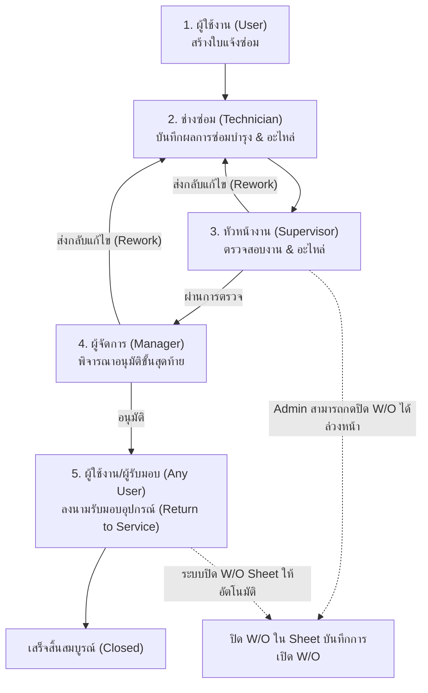

# คู่มือการใช้งานระบบใบแจ้งซ่อมอุปกรณ์ GSE ออนไลน์
## (Corrective Request & Work Order System)
**บริษัท ไทย ไลออน เมนทารี แอร์ไลน์ จำกัด (Thai Lion Air)**

---

## 📌 แผนผังภาพรวมขั้นตอนการทำงาน (Workflow Lifecycle)

---

## 1. คู่มือสำหรับผู้ใช้งานทั่วไป (User / Requester)

### 1.1 การเข้าสู่ระบบ
1. เปิดหน้าเว็บระบบ กรอก **รหัสพนักงาน (Employee ID)** ในรูปแบบ `TL` ตามด้วยตัวเลข 6 หลัก (รวม 8 ตัวอักษร เช่น `TL123456`)
2. กดปุ่ม **"เข้าสู่ระบบ"**

### 1.2 การสร้างใบแจ้งซ่อมใหม่ (New Request)
1. กดปุ่ม **"+ สร้างใบแจ้งซ่อมใหม่"** ที่มุมขวาบนของหน้าแดชบอร์ด
2. กรอกข้อมูลส่วนที่ 1:
   - **รหัสอุปกรณ์ GSE (Equipment Code) `*`:** 🔴 **จำเป็นต้องกรอก/เลือก** พิมพ์ค้นหารหัสอุปกรณ์ (เช่น `TLM-TT-001`) แล้วคลิกเลือกจาก Dropdown *(หมายเหตุ: อุปกรณ์ที่ถูกตั้งสถานะ Inactive จะไม่สามารถเลือกแจ้งซ่อมได้)*
   - **ชื่ออุปกรณ์ GSE (Equipment Name):** 🔒 **ไม่ต้องพิมพ์** เป็นช่องสีเทา Read-only ระบบจะดึงชื่อคำอธิบายอุปกรณ์มาใส่ให้อัตโนมัติทันที
   - **ชม. / กม. (Hr/Km):** ระบุชั่วโมงหรือเลขไมล์ปัจจุบันของอุปกรณ์ (ถ้ามี)
   - **วันที่ต้องการใช้งาน (Due Date):** กำหนดวันที่ต้องการให้อุปกรณ์พร้อมใช้งาน
   - **อาการชำรุดเสียหาย (Damage Appearance) `*`:** 🔴 **จำเป็นต้องกรอก** ระบุรายละเอียดความเสียหายหรือปัญหาที่พบให้ชัดเจน
   - **ผู้แจ้ง / รหัสพนักงาน:** 🔒 ดึงจากบัญชีผู้ใช้ที่ Login ให้อัตโนมัติ
   - **ชื่อผู้รับรอง / เบอร์โทร:** ระบุชื่อหัวหน้างานหรือผู้รับรองฝ่ายของผู้แจ้ง พร้อมเบอร์โทรศัพท์ติดต่อ
3. ตรวจสอบข้อมูลแล้วกด **"บันทึกใบแจ้งซ่อม"**
4. ใบแจ้งซ่อมจะถูกสร้างขึ้นด้วยสถานะ **"รอดำเนินการ"** พร้อมส่งการแจ้งเตือนไปยังกลุ่ม LINE โดยอัตโนมัติ

### 1.3 การติดตามสถานะอุปกรณ์ GSE
- **แท็บ "ใบแจ้งซ่อม":** ดูรายการใบแจ้งซ่อมทั้งหมด สามารถค้นหาตามรหัส, อาการ หรือกรองตามสถานะได้
- **แท็บ "สถานะอุปกรณ์ GSE":** ดูสรุปอุปกรณ์ที่กำลังแจ้งซ่อม อาการเสีย กำหนดวันเสร็จ (RTS Date) และสถานะกระบวนการซ่อม

### 1.4 การลงนามรับมอบอุปกรณ์ (Equipment Acceptance / Return to Service)
> **สำคัญ:** เมื่ออุปกรณ์ซ่อมเสร็จและผ่านการอนุมัติแล้ว **ผู้ใช้งานคนใดก็ได้ที่ไปรับรถแทน** สามารถกดรับมอบอุปกรณ์ได้ โดยไม่ต้องเป็นคนเดิมที่แจ้งซ่อม
1. ตรวจสอบในตาราง หากอุปกรณ์อยู่ในสถานะ **"รอผู้รับอุปกรณ์ลงนาม"** จะมีปุ่มไอคอนจับมือ <i class="fas fa-handshake"></i> แสดงขึ้นมา
2. กดที่ปุ่ม <i class="fas fa-handshake"></i> เพื่อเปิดหน้าต่างยืนยันการรับมอบ
3. ตรวจสอบความเรียบร้อยของอุปกรณ์จริง
4. กดปุ่ม **"ยืนยันรับมอบอุปกรณ์"**
5. ระบบจะบันทึก **ชื่อ-นามสกุล, รหัสพนักงาน, วันที่ และเวลาจริง** ของผู้กดรับมอบลงในช่อง *ผู้รับรอง (Admited By)* ในเอกสาร PDF และเปลี่ยนสถานะอุปกรณ์เป็น **"เสร็จสิ้น (Return to Service)"** ทันที

### 1.5 การพิมพ์เอกสารใบแจ้งซ่อม & ดูบนมือถือ (Print Form & Mobile View - v54)
1. กดปุ่มไอคอนรูปเครื่องพิมพ์ <i class="fas fa-print"></i> ในแถวของใบแจ้งซ่อมที่ต้องการ
2. ระบบจะเปิดหน้าพรีวิวแบบฟอร์มเอกสารมาตรฐานพร้อมข้อมูลครบถ้วน
3. **การใช้งานบนสมาร์ตโฟน (Mobile Optimization):**
   - เอกสาร A4 จะปรับสเกลพอดีหน้าจอมือถืออัตโนมัติ (Fit to Screen) ไม่ล้นขอบจอ
   - มีแถบเครื่องมือซูมด้านบน: `[-]` ซูมออก, `[100%]` ขนาดจริง, `[+]` ซูมเข้า, `[พอดีจอ]` ปรับขนาดพอดีหน้าจอ
   - รองรับการใช้นิ้วถ่างซูม (Pinch-to-zoom) เข้า-ออกได้อย่างอิสระบนหน้าจอมือถือ
4. กดปุ่ม **"พิมพ์ / บันทึกเป็น PDF"** เพื่อสั่งพิมพ์หรือบันทึกไฟล์

---

## 2. คู่มือสำหรับช่างซ่อมบำรุง (Technician)

### 2.1 การเข้าสู่ระบบ
- เข้าสู่ระบบด้วยรหัสพนักงานช่าง (เช่น `TL173663`, `TL184518`, `TL184711`, `TL184717`, `TL195537`, `TL237227`, `TL247471`) ระบบจะแสดงแถบสถานะเป็น **TECHNICIAN**

### 2.2 การบันทึกผลการซ่อมบำรุง (Maintenance Report)
1. ในตารางรายการใบแจ้งซ่อม ค้นหาใบงานที่ได้รับมอบหมาย (สถานะ *กำลังซ่อม* หรือ *รอดำเนินการ*)
2. กดปุ่มไอคอนประแจ <i class="fas fa-wrench"></i> **"บันทึกผลการซ่อมบำรุง"**
3. กรอกข้อมูลการซ่อมในแบบฟอร์ม:
   - **แนวทางการแก้ไข / รายละเอียดการซ่อมบำรุง (Maintenance Details):** ระบุสิ่งที่ตรวจพบและขั้นตอนการแก้ไขอย่างละเอียด
   - **เวลาปฏิบัติงานจริง (Actual Repair Time):** ระบุจำนวนชั่วโมงที่ใช้ซ่อม (เช่น `2 ชม. 30 นาที`)
   - **วันที่และเวลาที่ซ่อมเสร็จ:** ใส่วันที่ (วว/ดด/ปปปป) และเวลาเสร็จสิ้น
   - **กำหนดวันเสร็จ / พร้อมใช้งาน (RTS Date):** กำหนดวันและเวลาที่คาดว่ารถจะพร้อมใช้งาน
   - **รายชื่อช่างผู้ปฏิบัติงาน (Action By 1 - 3):** ระบุชื่อช่างที่ร่วมซ่อมได้สูงสุด 3 ท่าน
   - **รายการอะไหล่ที่ใช้ (Spare Parts):** กดปุ่ม *"+ เพิ่มรายการอะไหล่"* ระบุชื่ออะไหล่, พาร์ทนัมเบอร์ (Part No.), จำนวน และหน่วยนับ
4. ตรวจสอบความถูกต้อง แล้วกดปุ่ม **"บันทึกและส่งตรวจสอบ (Submit)"**
5. สถานะใบงานจะเปลี่ยนเป็น **"รอ Supervisor ตรวจสอบ"**

### 2.3 กรณีงานถูกส่งกลับแก้ไข (Rework)
- หากงานซ่อมถูกส่งกลับ หน้าจอจะมีข้อความเตือนระบุ **"เหตุผลที่ส่งกลับแก้ไข (Rework Reason)"** จาก Supervisor หรือ Manager
- ให้ช่างตรวจสอบแก้ไขตามข้อเสนอแนะ แล้วกดเข้าไปแก้ไขข้อมูลการซ่อม และกดบันทึกส่งตรวจสอบใหม่อีกครั้ง

---

## 3. คู่มือสำหรับหัวหน้าช่าง (Supervisor)

### 3.1 การเข้าสู่ระบบ
- เข้าสู่ระบบด้วยรหัสพนักงาน Supervisor (`TL130201`, `TL140729`, `TL237209`) ระบบจะแสดงสิทธิ์หัวหน้างาน

### 3.2 การตรวจสอบงานซ่อม (Supervisor Review)
1. ตรวจสอบในตาราง รายการที่มีสถานะ **"รอ Supervisor ตรวจสอบ"** จะแสดงปุ่มไอคอน <i class="fas fa-clipboard-check"></i>
2. กดปุ่ม <i class="fas fa-clipboard-check"></i> เพื่อเปิดหน้าต่างตรวจสอบงาน (Endorsement Modal)
3. ตรวจสอบข้อมูล:
   - รายละเอียดการซ่อมที่ช่างบันทึก
   - เวลาที่ใช้ซ่อมจริง และวันที่เสร็จสิ้น
   - รายการอะไหล่ที่ช่างเบิกใช้
4. **การตัดสินใจ:**
   - **กรณีผ่านการตรวจสอบ:** พิมพ์ข้อเสนอแนะ (ถ้ามี) แล้วกดปุ่ม **"ยืนยันผ่านการตรวจสอบ (ส่งต่อ Manager)"**
     - ระบบจะดึงชื่อ-นามสกุลของ Supervisor ลงในช่อง *Supervisor Approved* พร้อมวันที่-เวลาอัตโนมัติ
     - สถานะจะเปลี่ยนเป็น **"รอ Manager อนุมัติ"**
   - **กรณีพบข้อผิดพลาด/ต้องแก้ไข:** กดปุ่ม **"ส่งกลับให้ช่างแก้ไข"** พร้อมพิมพ์เหตุผลที่ต้องแก้ไขลงในช่อง *Rework Reason* จากนั้นกดยืนยัน งานจะถูกตีกลับไปหาช่างทันที

---

## 4. คู่มือสำหรับผู้จัดการฝ่ายซ่อมบำรุง (Manager)

### 4.1 การเข้าสู่ระบบ
- เข้าสู่ระบบด้วยรหัสพนักงาน Manager (`TL130056` Mr. Non Vismitananda)

### 4.2 การอนุมัติงานซ่อมบำรุง (Manager Approval)
1. ในตารางรายการ ค้นหาใบงานสถานะ **"รอ Manager อนุมัติ"** กดปุ่มไอคอนตราประทับ <i class="fas fa-stamp"></i>
2. ตรวจสอบความเรียบร้อยของงานซ่อม, รายการอะไหล่, และข้อเสนอแนะจาก Supervisor
3. **การตัดสินใจ:**
   - **กรณีอนุมัติ:** พิมพ์ข้อเสนอแนะ (ถ้ามี) แล้วกดปุ่ม **"อนุมัติงานซ่อม (Approve)"**
     - ระบบจะลงนามชื่อ Manager ในช่อง *Manager Approved* พร้อมวันที่-เวลา
     - สถานะใบงานจะเปลี่ยนเป็น **"รอผู้รับอุปกรณ์ลงนาม"** เพื่อส่งต่อให้อุปกรณ์พร้อมส่งมอบ
   - **กรณีส่งกลับแก้ไข:** กดปุ่ม **"ส่งกลับให้ช่างแก้ไข"** ระบุเหตุผลในช่อง *Rework Reason* เพื่อส่งกลับไปให้ช่างดำเนินการใหม่

---

## 5. คู่มือสำหรับผู้ดูแลระบบ (Admin)

### 5.1 สิทธิ์พิเศษของผู้ดูแลระบบ
- ผู้ดูแลระบบ (Admin เช่น `TL206992`, `TL120015`, `TL130201`, `TL140729`, `TL130056`, `TL237209`) มีสิทธิ์เต็มในการจัดการทุกขั้นตอนของระบบ

### 5.2 การจัดการและแก้ไขใบแจ้งซ่อม
1. **การลงเลขที่ใบสั่งงาน (Work Order No.):**
   - กดปุ่มไอคอนดินสอ <i class="fas fa-edit"></i> ที่ใบแจ้งซ่อม
   - กรอก **เลขที่ใบสั่งงาน (Work Order No.)**, วันที่/เวลารับงาน และผู้รับงาน ในส่วนที่ 2
   - กด **"บันทึกการแก้ไข"**
2. **การลบใบแจ้งซ่อม:**
   - กดปุ่มไอคอนถังขยะ <i class="fas fa-trash-alt"></i> ยืนยันการลบ ระบบจะลบข้อมูลทั้งในระบบและใน Sheet บันทึกการเปิด W/O ให้อัตโนมัติ

### 5.3 การปิดใบงาน W/O ใน Google Sheet (Direct Close W/O)
> **ฟังก์ชันพิเศษ:** Admin สามารถกดปิดสถานะ W/O ใน Sheet "บันทึกการเปิด W/O" ได้ทันทีตั้งแต่ขั้นตอนที่ Supervisor อนุมัติผ่าน (สถานะ *รอ Manager อนุมัติ* เป็นต้นไป) โดยไม่ต้องรอให้ถึงขั้นตอนรับมอบอุปกรณ์
- **วิธีที่ 1 (ผ่านตาราง):** กดปุ่มไอคอนโฟลเดอร์ <i class="fas fa-folder-minus"></i> ในคอลัมน์การดำเนินการ
- **วิธีที่ 2 (ผ่านหน้าต่าง Endorsement Modal):** กดปุ่มสีเขียว **"ปิดใบงาน W/O ใน Sheet"**
- เมื่อกดแล้ว สถานะ W/O ใน Sheet ประจำเดือนจะเปลี่ยนเป็น **CLOSED** ทันที พร้อมบันทึกวันที่ปิดงาน

### 5.4 การซิงค์และรีเฟรชข้อมูล (Manual Refresh)
- ระบบมีระบบแคชความเร็วสูง (SWR Cache) ที่เปิดหน้าเว็บได้ทันที 0ms
- หากต้องการดึงข้อมูลล่าสุดจาก Google Sheet ทันที สามารถกดปุ่มไอคอนรีเฟรช <i class="fas fa-sync-alt"></i> ที่แถบ Navbar ด้านบนขวาได้ตลอดเวลา

### 5.5 ระบบข้อมูลจำลองสำหรับนำเสนอ (Mockup Demo System)
- **สิทธิ์เฉพาะ Admin:** แอดมินสามารถกดปุ่ม **"ข้อมูลจำลอง"** บนแถบเมนูเพื่อสร้างชุดข้อมูลเคสตัวอย่างจำลองครบทั้ง 7 สถานะ (พร้อมส่ง LINE แจ้งเตือนเสมือนจริง) สำหรับใช้ในการพรีเซนต์หรือทดสอบระบบ
- **การลบข้อมูลจำลอง:** มีปุ่ม **"ลบข้อมูลจำลองทั้งหมด"** บนแถบแจ้งเตือน เพื่อเคลียร์ข้อมูลทดสอบย้อนหลังออกจากทั้งระบบ (ทั้งชีต Requests และชีต บันทึกการเปิด W/O) ในคลิกเดียว โดยไม่กระทบกับข้อมูลงานจริง

---

## 6. สรุปความหมายของสถานะใบงาน (Status Reference)

| สถานะ (Status) | สีสัญลักษณ์ | ความหมายและขั้นตอนถัดไป |
| :--- | :---: | :--- |
| **รอดำเนินการ** | สีเหลือง | ผู้ใช้เปิดใบแจ้งซ่อมเรียบร้อย ช่างกำลังเตรียมรับงาน |
| **กำลังซ่อม (Maintenance Process)** | สีน้ำเงิน | ช่างกำลังดำเนินการซ่อมบำรุงและรอลงบันทึกผลการซ่อม |
| **รอ Supervisor ตรวจสอบ** | สีเขียวอมฟ้า | ช่างซ่อมเสร็จแล้ว รอหัวหน้าช่างตรวจสอบรายละเอียดและอะไหล่ |
| **รอ Manager อนุมัติ** | สีม่วง | หัวหน้าช่างตรวจผ่านแล้ว รอผู้จัดการฝ่ายอนุมัติขั้นสุดท้าย *(Admin ปิด W/O ได้)* |
| **รอผู้รับอุปกรณ์ลงนาม** | สีฟ้าสด | ผู้จัดการอนุมัติแล้ว รถพร้อมส่งมอบ ผู้ใช้คนใดก็ได้สามารถมารับรถและกดลงนาม |
| **เสร็จสิ้น (Return to Service)** | สีเขียว | อุปกรณ์ได้รับการส่งมอบกลับสู่การใช้งานเรียบร้อยสมบูรณ์ |
